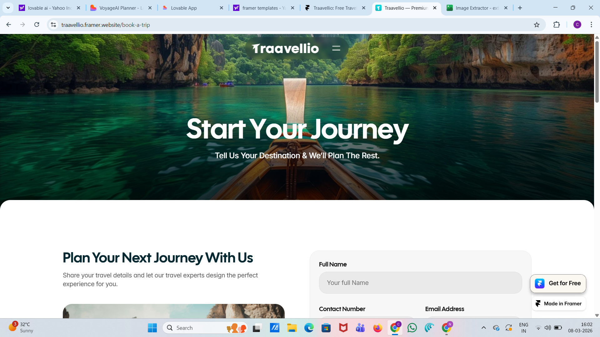
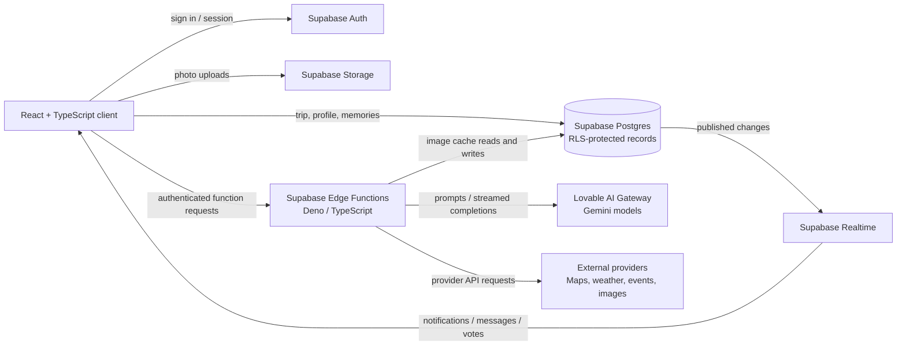
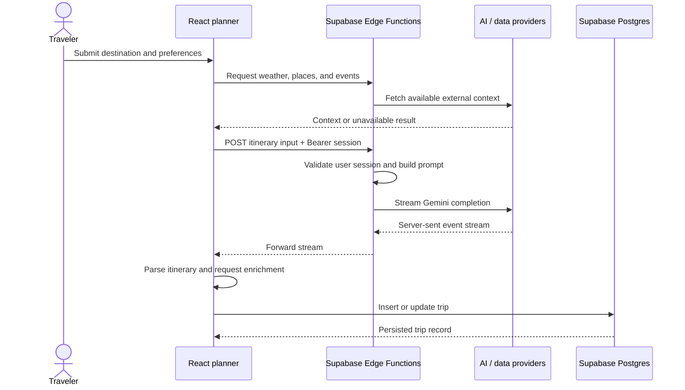
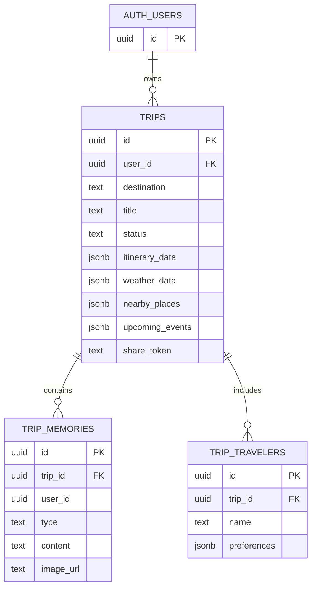

# VoyageAI Planner

**A full-stack travel-planning app that turns trip preferences into an enriched, editable itinerary.**

VoyageAI Planner combines streamed AI itinerary generation with traveler preferences, place and route lookups, and Supabase-backed trip storage.

[](https://react.dev/)
[](https://www.typescriptlang.org/)
[](https://vite.dev/)
[](https://supabase.com/)

## Preview



This is existing project artwork, not a product screenshot. The repository does not include a UI screenshot or hosted demo URL.

## Contents

- [Overview](#overview)
- [Core features](#core-features)
- [System architecture](#system-architecture)
- [Technical stack](#technical-stack)
- [Key workflows](#key-workflows)
- [Project structure](#project-structure)
- [Getting started](#getting-started)
- [Environment variables](#environment-variables)
- [API reference](#api-reference)
- [Data model](#data-model)
- [AI integration](#ai-integration)
- [Testing and quality](#testing-and-quality)
- [Deployment](#deployment)
- [Engineering decisions and trade-offs](#engineering-decisions-and-trade-offs)
- [Limitations and potential next steps](#limitations-and-potential-next-steps)
- [Contributing and license](#contributing-and-license)

## Overview

VoyageAI Planner is a browser-based trip planner for travelers who want more than a destination search or a one-shot text response. A traveler can provide a destination, dates, budget, group size, interests, and travel style; the app generates a day-by-day plan, enriches it with available external data, and saves it to a personal trip dashboard.

The engineering focus is the flow around generation: authenticated requests to server-side functions, streamed model output, enrichment through separate providers, persistence with row-level security, and optional post-generation editing. It is designed for individual trip planning, with some group-oriented interfaces and data structures that are not yet a full shared-traveler collaboration system.

## Core features

### Implemented

- **Account-based trip planning.** Email/password sign-up and sign-in use Supabase Auth. Signed-in users can save, revisit, update, and organize trips by planned, active, or completed status.
- **Preference-driven itinerary generation.** The planning flow collects dates, destination, budget, party size, interests, travel styles, and an optional travel vibe. Planning modes and day-by-day intensity settings are included in the generation request.
- **Streamed AI output.** The browser reads server-sent events from the planner function and displays text as it arrives. Once generation finishes, the client parses the returned JSON and builds the itinerary view.
- **External trip context.** Where configured, the app requests a five-day weather forecast, Google Maps place and route data, and Ticketmaster events. The planner can use returned data as context; unavailable enrichment is not equivalent to a verified recommendation.
- **Itinerary enrichment.** After generation, the client can request place images, geocode activity locations, estimate routes between mapped activities, and check activity booking pages for published prices. Price checks explicitly return `verified` or `unavailable`; they are not bookings or guaranteed quotes.
- **Traveler profile and trip memories.** Profile preferences and trip-pattern fields are persisted in Supabase. Users can save journal entries and upload trip photos to the `trip-photos` storage bucket.
- **Trip stories and sharing.** An AI-generated narrative can be stored with a completed trip. A share token can expose a trip story through a public shared-story route.
- **Live notification and collaboration primitives.** Notification records use Supabase Realtime. Trip messages and place votes also have database tables and Realtime publication, while group-planning UI can store traveler preferences and request AI suggestions. Current row-level security policies do not provide general guest access to these group records.
- **Trip exports and booking requests.** PDF export code is present. Tour inquiry forms can create booking-request records; they do not complete a reservation with a provider.

### Partially implemented or static

- The itinerary sidebar chat currently returns a canned acknowledgement; it is not connected to an AI conversation endpoint.
- Several discovery and tour experiences are populated from local frontend data and bundled images rather than a live inventory or booking service.
- The database supports some group features, but current access policies are owner-oriented. Do not treat the interface as proof of multi-user collaboration.
- Some itinerary actions and non-PDF export options are presentation-only or marked as coming soon.

## System architecture

The browser is the application client and uses the Supabase JavaScript SDK for authentication, direct data access, storage, and Realtime subscriptions. Edge Functions handle model calls and third-party integrations that should not expose provider credentials to the browser.



Supabase Auth sessions are persisted and refreshed by the client. Sensitive provider keys are read by Edge Functions from their runtime environment. Shared session and signed-photo URL helpers live in [`supabase/functions/_shared/security.ts`](supabase/functions/_shared/security.ts).

## Technical stack

| Area | Technologies | Responsibility |
|---|---|---|
| Client | React 18, TypeScript, Vite | Single-page application and development/build tooling |
| UI | Tailwind CSS, Radix UI/shadcn-style components, Lucide, Framer Motion | Styling, accessible primitives, icons, and transitions |
| Navigation and client state | React Router, TanStack Query, React Context | Routes, query-client setup, authentication and notification state |
| Backend platform | Supabase Auth, Postgres, Storage, Realtime, Edge Functions | Identity, persisted data, uploads, change subscriptions, and server-side integrations |
| Edge runtime | Deno and TypeScript | Function handlers, request validation, provider calls, and shared security utilities |
| AI | Lovable AI Gateway with Google Gemini models | Streaming itinerary generation and supporting travel-generation functions |
| External data | Google Maps Platform, OpenWeatherMap, Ticketmaster, image providers | Place search, geocoding/directions, forecast, events, and destination imagery |
| Database migrations | Supabase SQL migrations, Drizzle Kit migrations | Schema changes split across `supabase/migrations/` and `drizzle/migrations/` |
| Quality tools | Vitest, Testing Library, jsdom, ESLint | Client test runner, DOM test environment, and linting |

## Key workflows

### Generate and save an itinerary

1. The traveler completes the planning form in [`src/pages/PlanTrip.tsx`](src/pages/PlanTrip.tsx). If signed in, the page can also load an existing trip for editing.
2. The client requests weather, nearby places, and events from separate Edge Functions. It also reads the current traveler profile.
3. [`src/lib/streamChat.ts`](src/lib/streamChat.ts) posts the planning inputs and available context to `ai-travel-planner` with the user's access token.
4. The function validates the user session, constructs a prompt, and streams a completion from the Lovable AI Gateway. The browser consumes the event stream and accumulates the generated text.
5. On completion, the browser parses the JSON, optionally checks prices, requests images and coordinates, and asks Google Maps for route estimates between mapped activities. These enrichment requests are separate from the model response.
6. The completed itinerary and related context are inserted into or used to update the user's `trips` record. Database row-level security enforces ownership.



### Edit a day

The itinerary page can call `regenerate-day` with the destination, selected day, existing activities, preferences, and constraints. The function requests a replacement day from the AI Gateway; the client then updates the itinerary stored in the trip. The separate free-form itinerary chat described above is not this workflow and remains a placeholder.

### Keep trip media and notifications

Trip journal entries and photo metadata are stored in `trip_memories`; uploaded images go to Supabase Storage. Notification rows are persisted in `notification_inbox` and subscribed to through Realtime. Booking reminders are drafted by client-side notification logic when the app loads; there is no scheduled background job in the repository.

## Project structure

```text
src/
  pages/                  Routed application screens
  components/             Shared UI and trip-planning components
  contexts/                Authentication and notification state
  hooks/                   Trip, profile, and memory data access
  integrations/supabase/   Supabase client and generated database types
  lib/                     Streaming, pricing, and PDF-export helpers
  test/                    Vitest setup and tests
supabase/
  functions/               Deno Edge Function handlers
    _shared/               Shared auth and signed-photo URL helpers
  migrations/              Supabase SQL schema changes
drizzle/
  migrations/              Drizzle-managed SQL migrations
public/                     Static public assets
src/assets/                 Bundled illustrations and destination imagery
```

## Getting started

### Prerequisites

- Node.js and npm. The repository does not pin a Node.js version.
- A Supabase project for Auth, Postgres, Storage, and Edge Functions.
- Supabase CLI and a database connection string if applying migrations or deploying functions from a local machine.
- Provider credentials for the features you intend to run; see [Environment variables](#environment-variables).

### Install and run the client

```bash
git clone <repository-url>
cd voyageai-planner
npm ci
```

Create a local `.env.local` file in the repository root and set the three `VITE_` variables listed below. The repository does not currently include an `.env.example`.

```dotenv
VITE_SUPABASE_URL=https://<project-ref>.supabase.co
VITE_SUPABASE_PUBLISHABLE_KEY=<publishable-key>
VITE_SUPABASE_PROJECT_ID=<project-ref>
```

```bash
npm run dev
```

Vite is configured to listen on port `8080`; use the URL printed by Vite.

### Configure Supabase

1. Create a Supabase project and configure the Auth providers needed by the app.
2. Set the client values in `.env.local`.
3. Apply the Supabase SQL migrations, then the separate Drizzle migrations. The latter requires `LOVABLE_DB_MIGRATION_URL` to be set in the shell that runs Drizzle.
4. Configure Edge Function secrets for the integrations you plan to use.
5. Deploy the Edge Functions used by those features.

With the Supabase CLI installed and authenticated, link the project and apply Supabase migrations:

```bash
supabase login
supabase link --project-ref <project-ref>
supabase db push
```

Apply the Drizzle migration directory separately:

```bash
npx drizzle-kit migrate
```

`drizzle.config.ts` reads `LOVABLE_DB_MIGRATION_URL` from the process environment. Ensure it points to the same database after the Supabase migrations have been applied.

## Environment variables

There is no checked-in `.env.example`. The list below is based on variable references in the client, Edge Functions, and migration configuration. Never put server-side provider secrets in a `VITE_` variable; Vite exposes those values to browser code.

### Client build variables

| Variable | Required for | Description |
|---|---|---|
| `VITE_SUPABASE_URL` | Client startup and Supabase calls | Supabase project URL |
| `VITE_SUPABASE_PUBLISHABLE_KEY` | Client startup and Supabase calls | Supabase publishable/anon client key; this is intended for browser use and is not a service-role secret |
| `VITE_SUPABASE_PROJECT_ID` | AI destination discovery | Project reference used by the discovery component to construct its Edge Function URL |

### Edge Function and migration variables

Set provider credentials and `PHOTO_PROXY_SIGNING_SECRET` as Supabase Edge Function secrets. Supabase supplies `SUPABASE_URL` and `SUPABASE_ANON_KEY` in the Edge Function environment; `place-images` also needs `SUPABASE_SERVICE_ROLE_KEY` available server-side. `LOVABLE_DB_MIGRATION_URL` is used by the local Drizzle CLI.

The two client connection values are required for the app to initialize; the project ID is needed for AI discovery. Edge credentials are required only for their corresponding integrations. Image providers other than Google Maps are optional for the application as a whole; the dedicated Unsplash endpoint itself requires an Unsplash key, while the batch resolver can try other configured sources.

| Variable | Needed for | Notes |
|---|---|---|
| `LOVABLE_API_KEY` | AI itinerary, discovery, day regeneration, stories, and other AI functions | Required by each AI function when invoked; used server-side with the Lovable AI Gateway |
| `GOOGLE_MAPS_API_KEY` | Places, geocoding, directions, and Google photo proxy | Required for Google Maps-backed operations |
| `PHOTO_PROXY_SIGNING_SECRET` | Signed Google Maps photo URLs | Used by shared signed-URL creation and verification |
| `OPENWEATHERMAP_API_KEY` | Weather endpoint | OpenWeatherMap geocoding and five-day forecast |
| `TICKETMASTER_API_KEY` | Event lookup | Ticketmaster Discovery API |
| `UNSPLASH_ACCESS_KEY` | Unsplash image search and image resolution | Optional if other configured image sources can satisfy requests |
| `PEXELS_API_KEY` | Pexels image fallback | Optional |
| `PIXABAY_API_KEY` | Pixabay image fallback | Optional |
| `SUPABASE_URL` | Edge Function authentication and database access | Supabase provides this project setting in its Edge Function environment |
| `SUPABASE_ANON_KEY` | Edge Function session validation and Supabase client access | Supabase provides the anon key to Edge Functions |
| `SUPABASE_SERVICE_ROLE_KEY` | `place-images` cache reads/writes | Server-only privileged key; never expose it in the client |
| `LOVABLE_DB_MIGRATION_URL` | `npx drizzle-kit migrate` | PostgreSQL connection URL read by [`drizzle.config.ts`](drizzle.config.ts); not needed by the running Vite client |

External-provider variables are feature-specific: a missing optional provider can leave the related weather, event, map, or image enrichment unavailable. AI functions that require `LOVABLE_API_KEY` return an error if it is not configured.

## API reference

The backend is a set of Supabase Edge Functions, not a REST server with a separate router. Function URLs use:

```text
<VITE_SUPABASE_URL>/functions/v1/<function-name>
```

Unless noted otherwise, request examples use JSON. “Session required” describes the function's own user-session validation; the Supabase gateway may also apply JWT verification according to its project configuration.

| Method and function | Purpose | Authentication |
|---|---|---|
| `POST /ai-travel-planner` | Stream a preference- and context-aware itinerary | User access token required by handler |
| `POST /ai-discover` | Generate destination suggestions from a text query | User access token required by handler |
| `POST /regenerate-day` | Generate a replacement itinerary day | User access token required by handler |
| `POST /google-maps` | Search places, geocode, or request route estimates/directions | User access token required by handler |
| `POST /activity-prices` | Check supplied booking URLs for parseable price data | User access token required by handler |
| `POST /place-images` | Resolve place images and use the database cache | User access token required by handler |
| `POST /weather` | Return a location and available five-day forecast | No per-user session check in handler |
| `POST /ticketmaster` | Search events by destination/date/keyword | No per-user session check in handler |
| `POST /unsplash`, `POST /unsplash-batch` | Search and batch-resolve destination images | No per-user session check in handler |
| `GET /google-maps-photo` | Proxy a Google Maps photo through an expiring signed URL | Signed query parameters; no user session |
| `POST /ai-travel-story`, `/ai-travel-suggestions`, `/ai-group-suggestions`, `/ai-local-experiences` | Supporting story, recommendation, group, and local-experience AI requests | User access token required by handlers |

### Generate an itinerary

`POST /functions/v1/ai-travel-planner` accepts a bearer token from the signed-in Supabase session. `destination`, `startDate`, `endDate`, `budget`, `styles`, `groupSize`, and `interests` are used to build the prompt. The client may also send `travelVibe`, `planningMode`, weather, nearby places, events, a traveler profile, and narrative intensities.

```http
POST /functions/v1/ai-travel-planner
Authorization: Bearer <user-access-token>
Content-Type: application/json
```

```json
{
  "destination": "Kyoto, Japan",
  "startDate": "2027-04-10",
  "endDate": "2027-04-13",
  "budget": 1800,
  "styles": ["culture", "food"],
  "groupSize": 2,
  "interests": ["temples", "local cuisine"],
  "travelVibe": "slow and local",
  "planningMode": "smart_balanced"
}
```

The successful response is `text/event-stream`, forwarding model events. Content arrives in `choices[0].delta.content` chunks; the client concatenates the text, parses the resulting JSON, and then performs separate enrichment requests. The function returns JSON errors for authentication, configuration, rate-limit, and upstream-credit failures.

### Other request shapes

`POST /functions/v1/ai-discover` accepts `{"query":"quiet coastal towns for a week"}` and returns `{"results":[...]}`. `POST /functions/v1/regenerate-day` accepts an existing day context such as `destination`, `dayNumber`, `date`, `theme`, `currentActivities`, preferences, and optional constraints.

`POST /functions/v1/google-maps` dispatches on `action`. All actions require a user session:

```json
{ "action": "geocode", "query": "Kyoto Station, Kyoto" }
```

Other validated actions include `search`, `nearby`, `details`, `route_estimates`, `directions_steps`, and `sign_photo`. Route estimates compare walking, transit, and driving where available.

`POST /functions/v1/weather` accepts `{"destination":"Kyoto, Japan","startDate":"2027-04-10","endDate":"2027-04-13"}` and returns a geocoded location plus a five-day forecast. The date fields are accepted by the handler but the provider request is a five-day forecast; the endpoint does not produce arbitrary date-range forecasts.

`POST /functions/v1/activity-prices` accepts an `activities` array (up to 60 entries) with `key`, `title`, and `bookingUrl`. Each result is marked `verified` only when a supported price can be parsed from the supplied HTTPS page; otherwise its status is `unavailable`.

## Data model

Supabase Postgres is the system of record. Trip itinerary and provider context are stored as JSONB, while frequently edited trip metadata and ownership are separate columns.



The diagram shows declared foreign keys from the migrations. Other records include `traveler_profiles`, `trip_messages`, `trip_place_votes`, `notification_inbox`, `notification_preferences`, `bookings`, and `place_image_cache`. Several of those tables use user or trip identifiers without declaring database foreign-key constraints.

Row-level security policies protect trip ownership, profile and memory records, storage uploads, and most auxiliary tables. Shared trip reads use a `share_token`; the `trip-photos` storage bucket is public. Realtime publication is configured for notifications, trip messages, and place votes.

## AI integration

The planner Edge Function calls the Lovable AI Gateway using `google/gemini-2.5-flash` with streaming enabled. Its prompt specifies a structured JSON itinerary and can include user preferences, profile patterns, weather, nearby places, events, planning mode, and day-level intensity.

The client parses the completed stream as JSON, strips optional Markdown fences, and attempts to recover an object from surrounding text. It does not validate the result against a runtime schema before persisting it. A malformed completion therefore produces a parse error rather than a deterministic fallback itinerary.

Other AI functions use Gemini models through the same gateway for discovery, day regeneration, travel stories, suggestions, group suggestions, and local experiences. AI-generated venue details and advice should be treated as recommendations, not guaranteed facts. Maps results can provide place and route context, and price extraction reports when it could not verify a price; neither guarantees every generated claim.

## Testing and quality

The project uses Vitest with a jsdom environment and Testing Library. At the time this README was written, the only checked-in test is a minimal example assertion in `src/test/example.test.ts`; it is not meaningful coverage of application workflows.

```bash
npm test       # vitest run
npm run lint   # eslint .
npm run build  # vite build
```

The test suite and production build were run while preparing this README: **1 test passed**, and **the Vite production build completed successfully**. No feature-level coverage or end-to-end test suite is configured.

## Deployment

The repository has no checked-in CI/CD workflow, container definition, or hosting-provider configuration. A deployment therefore requires manual setup:

1. Apply the Supabase and Drizzle migrations as described in [Getting started](#getting-started).
2. Add the required provider secrets to the Supabase project.
3. Deploy each Edge Function used by the enabled features, for example:

   ```bash
   supabase functions deploy ai-travel-planner
   supabase functions deploy google-maps
   ```

4. Build the client with `npm run build` and publish the generated `dist/` directory to a static host.
5. Configure the host to serve the SPA entry point for client-side routes, and provide the three `VITE_` values at build time.

Functions whose names appear in the API table need deployment when their associated feature is enabled. Keep provider keys and the Supabase service-role key in the server-side function environment, not in the static client build.

## Engineering decisions and trade-offs

- **Supabase-backed client data access:** the frontend uses the Supabase SDK for user-scoped CRUD rather than routing every database request through a custom API server. This keeps the backend smaller, but correctness depends on the RLS policies matching each UI capability.
- **JSONB for generated itineraries:** a flexible itinerary payload can evolve without a column migration for every generated field. The trade-off is weaker database-level validation and more reliance on loosely typed client objects.
- **Stream first, persist after parsing:** the planner exposes model output while it is generated, then the browser parses and enriches the result before saving. This preserves a responsive generation flow but means the saved itinerary depends on successful completion and parsing.
- **Separate enrichment services:** images, maps, weather, events, and price checks are isolated from the core model call. Provider data can improve relevance, but it introduces credentials, availability, rate limits, and uneven fallback behavior.
- **Explicit user validation in functions:** shared helpers validate Supabase user sessions for core AI and map operations. Signed photo proxy URLs use an HMAC signature and expiry rather than exposing the upstream photo key.
- **Two migration tracks:** core Supabase SQL and Drizzle SQL are stored in separate directories and require separate migration commands. Deployment must apply them in the correct order.

## Limitations and potential next steps

### Current limitations

- Weather integration returns an OpenWeatherMap five-day forecast, not a forecast covering any requested trip dates.
- AI output is parsed as JSON but is not checked against a complete runtime itinerary schema before storage.
- The itinerary chat response is hard-coded; several tour and discovery records are local content rather than live inventory.
- A booking form stores an inquiry record, and itinerary price extraction checks public page markup. Neither completes an external booking or guarantees current pricing.
- Notification reminders are generated by client-side logic rather than a scheduler or background worker.
- Group-related records and Realtime subscriptions exist, but current access policies do not enable general collaboration among invited travelers.
- Automated tests currently cover only a trivial example; there are no workflow, integration, or browser tests in the repository.

### Potential next steps (not a committed roadmap)

- Add schema validation and focused tests for streamed model output, persistence, and provider error handling.
- Connect itinerary chat to a real, scoped AI operation or remove the interactive affordance until it is available.
- Define guest/member roles and corresponding RLS policies before presenting group features as collaborative.
- Move reminders to a scheduled backend process if they must run without a user opening the app.
- Replace static tour records with an explicitly integrated inventory source before presenting reservations as bookable.

## Contributing and license

No `CONTRIBUTING.md` or license file is present in the repository, so there is no documented contribution process or license grant to summarize. Confirm the project's licensing terms before redistributing or reusing the code.
